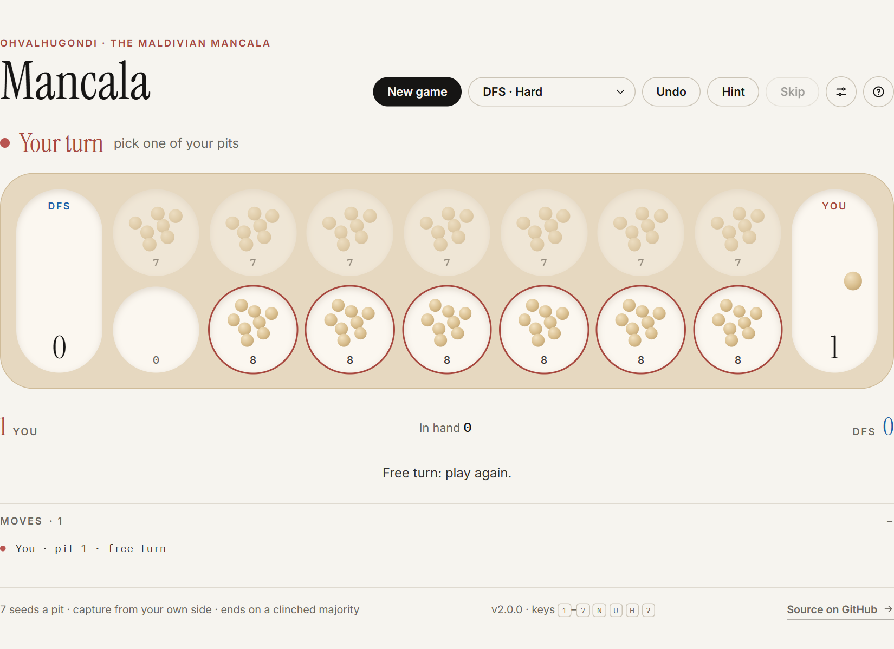
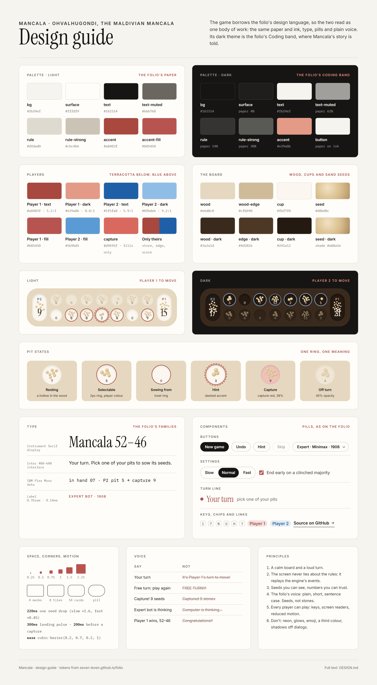

# Mancala

**Ohvalhugondi, the Maldivian mancala, in the browser.** Seven pits a side, seven seeds in each, and relay sowing. Play
a friend on the same screen, or one of seventeen bots from Hopeless to Expert, and keep an Elo rating of your own.

**Play: [seven-leven.github.io/mancala](https://seven-leven.github.io/mancala/)**



I started this in December 2022 to build a bot that could beat my grandmother at ohvalhugondi. The command-line game
came first; the bot (the DFS one below) came in August 2024; the web version in 2025; and this TypeScript rewrite in
October 2026. [The full story](https://seven-leven.github.io/folio/code-mancala.html) is on my folio.

## How to play

- Pick one of your pits. Its seeds are sown one by one, counter-clockwise, past your store but never into your
  opponent's.
- **Relay:** if the last seed lands in a pit that already had seeds, pick them all up and keep sowing.
- **Free turn:** if the last seed lands in your own store, play again.
- **Capture:** if the last seed lands in an empty pit on your side, bank everything in the pit opposite. The seed that
  landed stays put.
- The game ends when a side runs out of seeds, or as soon as a store holds more than half of all 98. Each player banks
  what's left on their side, and the fuller store wins.

House rules in Settings change the seeds per pit (3–15), let captures happen on either side, or turn off the early
finish. Keys: `1`–`7` play your pits (counted from your own left), `N` new game, `U` undo, `H` hint, `S` skip, `?` the
rules.

### Going first decides a lot

Relay sowing and free turns make long chains, and one good chain can end the game. With the standard rules the Minimax
bot proves that **the first player wins by force: opening with pit 1 starts a chain of free turns that clinches the
majority before the other side ever moves.** Minimax against itself ends 94–4. With the early finish turned off, pit 1
still leaves the first player about 77 seeds ahead with best play, and every other opening leaves them behind. That's
why Settings lets you choose who goes first.

## The bots


| Level      | Bot                |  Elo | 90% range | How it plays                                                               |
| ---------- | ------------------ | ---: | :-------: | -------------------------------------------------------------------------- |
| Expert     | Minimax            | 1974 | 1939–2014 | Alpha-beta search with a transposition table; follows free-turn chains     |
| Hard       | DFS                | 1898 | 1859–1941 | Chains its own free turns as far as they go (the original 2024 bot)        |
| Sharp      | Shrewd             | 1845 | 1813–1883 | Lookahead's method, three moves deep instead of two                        |
| Tricky     | Lookahead          | 1689 | 1656–1730 | Two moves deep, and picks one of its better moves, not always the best     |
| Thoughtful | Planner            | 1669 | 1633–1705 | Two moves deep, weighing free turns set up, captures threatened, open pits |
| Keen       | Chainer            | 1470 | 1436–1509 | Usually takes a free turn or two before banking; otherwise like Greedy     |
| Crafty     | Spoiler            | 1447 | 1414–1481 | Often plays to leave your best reply weakest; otherwise like Greedy        |
| Average    | Greedy             | 1319 | 1286–1351 | Takes whatever banks the most seeds this turn                              |
| Careful    | Turtle             | 1303 | 1276–1334 | Banks what it can, but won't leave a loaded pit open to capture            |
| Relaxed    | Sometimes greedy   | 1211 | 1182–1243 | Greedy's move half the time, any legal pit the rest                        |
| Bold       | Striker            | 1154 | 1124–1187 | Banks what it can, but would rather line up a capture for next turn        |
| Casual     | First              | 1012 | 982–1042  | Always plays its first pit with seeds, from its own left                   |
| Easy       | Random             | 1000 |  anchor   | Any legal pit                                                              |
| Thrifty    | Hoarder            |  951 |  914–983  | Keeps its seeds on its own side, banking only a little                     |
| Gentle     | Sometimes generous |  776 |  740–819  | Generous's move most of the time, any legal pit the rest                   |
| Very easy  | Generous           |  638 |  600–678  | Greedy's opposite: banks as little as it can                               |
| Hopeless   | Pushover           |  566 |  520–599  | Searches ahead like Minimax, but to lose by as much as it can              |

The ratings come from `deno task tournament`: every bot plays every other 60 times, in matched pairs. Each pair of games
starts from the same opening (the standard board after two random moves), once with each bot in each seat, so an opening
that favours one side comes out even. Elo is fitted to all the results at once, and Random is pinned at 1000.

Bots were added where the ladder had gaps: a game between bots close in strength tells you far more than a 100–0
mismatch, so every new neighbour firms up the ratings around it. With seventeen bots and 60 games a pairing, every 90%
range is within ±40. [BOTS.md](BOTS.md) has the standard every bot follows. A Grandmaster (Minimax searching deeper) is
built but dormant: it rated level with Minimax for five times the time.

**Read them as a ladder, not exact numbers.** Many pairings end 100–0, which only says one bot is much stronger, not how
much; those gaps come from the closer pairings in between. The 90% ranges (from re-fitting resampled results) show how
firm each number is. Four neighbouring pairs are too close to call (red in the chart): Minimax and DFS (Minimax won 52%
of their 60 games), Lookahead and Planner (48%), Chainer and Spoiler (53%), and Greedy and Turtle (58%).

**Your rating.** Finished games are saved in your browser, and your own Elo is worked out from them (everyone starts at
1000, level with Random). A game is rated when it's you against one bot, played to the end under the standard rules,
without Undo or Hint. Each saved game keeps the bot's rating from the day you played, so adding bots later doesn't
rewrite your history. "Your games" shows the rating, its trend, your record against each bot, and a backup button.

## How it's built

TypeScript on [Deno](https://deno.com), bundled with esbuild, no runtime dependencies.

```
src/game/    the rules: one pure engine, playTurn(), that returns the new state and an event log;
             and MGN, the game notation (notation.ts, see NOTATION.md)
src/bots/    the bot list the game uses (bots.ts), the ratings, and the Web Worker they run in
  players/   the bots, by family: basic, one-move, chain, search and mixed (see BOTS.md)
  search/    the Minimax search, and the scoring pieces bots share (evaluate.ts)
src/ui/      the board, the stats dialog, sound
src/app/     the turn loop (game.ts), settings, saved games and your rating
public/      the page and its styles
tests/       the rules, the bots, the rating maths
tools/       build, release, bench, design sheet, the ladder chart (ladder.ts), bot-against-bot games (match.ts)
  tournament/  rates the bots: the games (main.ts), openings, checkpoints and the Elo fit (elo.ts)
  positions.ts  recorded games to training data for the evaluation
```

**The screen never re-implements the rules.** `playTurn()` records every pickup, drop, capture and sweep as it plays a
move; the animation only replays that log, so what you see is what the engine did. Bots run in a Web Worker, so a long
search never freezes the page.

**The design** follows [DESIGN.md](DESIGN.md), which borrows the folio's paper, ink, type and pills so the two read as
one body of work. Here it is on one sheet ([docs/design-guide.png](docs/design-guide.png)):



### Working on it

```sh
deno task dev          # build, watch, and serve at http://localhost:8010/
deno task test         # the rules, bots and ratings
deno task check        # type check
deno task tournament   # rate the bots (add --write to update the menus)
deno task bench        # how deep and fast Minimax searches
deno task ladder       # redraw docs/ladder.svg from the ratings
deno task profile      # where a tournament round spends its time (data/profile/)
deno task release      # from dev: check everything, then ship to main
```

Every push runs the same checks on GitHub. A push to `main` builds the site and publishes `dist/` to the `gh-pages`
branch, which GitHub Pages serves. Work happens on `dev`. `main` is protected: it only takes a pull request whose checks
passed, never a direct push or a force-push. `deno task release` opens that pull request from `dev` (or uses the open
one), waits for its checks, merges it, and waits for the deploy.

To add a bot, follow [BOTS.md](BOTS.md): write it in its family's file in `src/bots/players/`, add it to `BOTS` in
`src/bots/bots.ts`, and run `deno task tournament --write`. The tournament rates everything in `BOTS`.

## Changes

See [CHANGELOG.md](CHANGELOG.md).

## Licence

All rights reserved: see [LICENSE](LICENSE). You're welcome to read the code and play the game.
