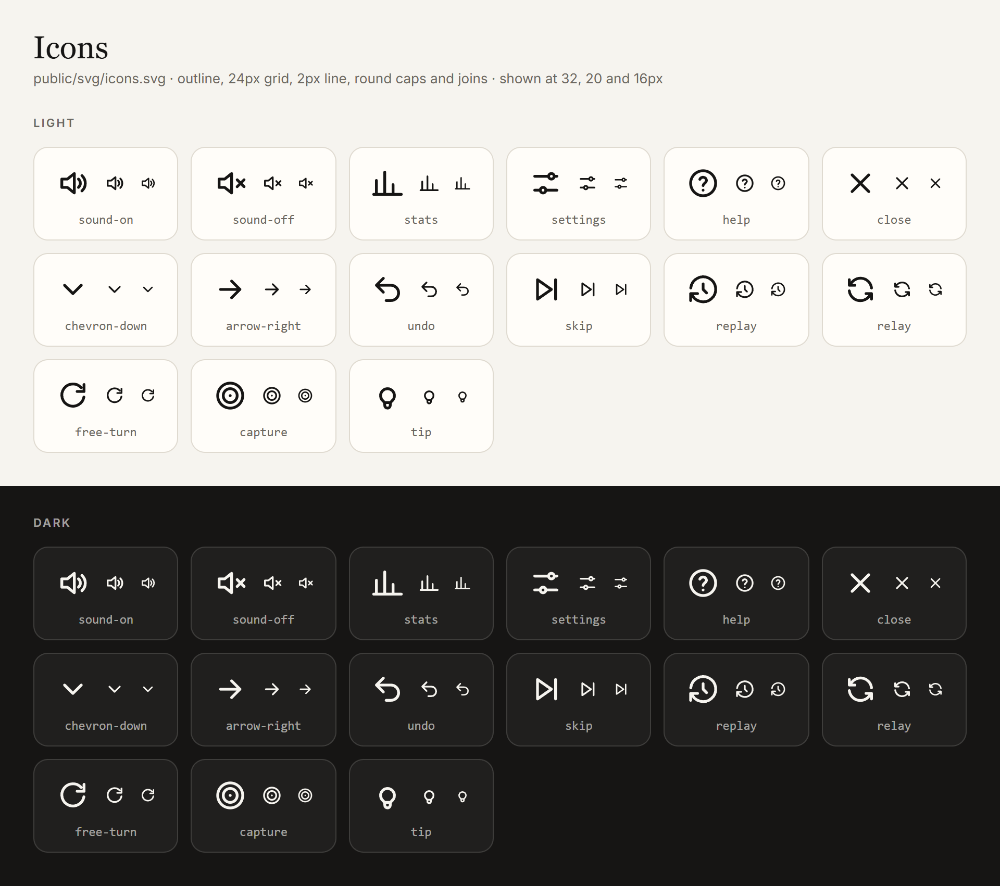

# Design guide

How the Mancala site looks and sounds, and why. Read this before changing the interface.

The game is a sibling of my portfolio, [seven-leven.github.io/folio](https://seven-leven.github.io/folio/), and borrows
its design language so the two read as one body of work: same paper and ink, same type, same pills and labels, same
plain voice. On the folio, Mancala lives in the **Coding** timeline, which is a dark band. The game's dark theme _is_
that band, and its light theme is the folio's paper page.

The tokens below are copied from the folio's `site/assets/css/main.css`. If the folio changes a value, change it here
too.

## Principles

1. **A calm board and a loud turn.** The board is quiet: wood, sand-coloured seeds, no glow. The one thing that shouts
   is whose turn it is, and which pits they can play.
2. **The screen never lies about the rules.** The rules run once, in `src/game/engine.ts`. The animation only replays
   the event log that the engine wrote, so what you see is always what happened.
3. **Seeds you can see, numbers you can trust.** Each pit draws its seeds and shows the exact count. Up to 24 seeds are
   drawn in a pit and 60 in a store; past that, the number carries it.
4. **The folio's voice.** Sentence case, short plain sentences, no exclamation marks except "Free turn" and "Capture",
   which are events in the game. Say "seeds", not "stones": ohvalhugondi is played with seeds, and the folio says so.
5. **Every player can play.** Keyboard, screen reader and reduced motion are part of the design, not an add-on.

## Tokens

### Palette

| Token           | Light (paper) | Dark (the folio's Coding band) | Use                          |
| --------------- | ------------- | ------------------------------ | ---------------------------- |
| `--bg`          | `#f6f4ef`     | `#161514`                      | Page                         |
| `--surface`     | `#fffdf9`     | `rgba(246,244,239,0.04)`       | Cards, dialogs, the log      |
| `--text`        | `#161514`     | `#f6f4ef`                      | Body and headings            |
| `--text-2`      | `#34322f`     | `rgba(246,244,239,0.75)`       | Secondary text               |
| `--text-muted`  | `#6b6760`     | `rgba(246,244,239,0.62)`       | Labels, captions, hints      |
| `--rule`        | `#dfdad0`     | `rgba(246,244,239,0.14)`       | Hairlines, card borders      |
| `--rule-strong` | `#cbc4b6`     | `rgba(246,244,239,0.30)`       | Ghost buttons, pills         |
| `--accent`      | `#a8483f`     | `#e39a86`                      | Links and focus (terracotta) |

Like the folio, components only use these semantic roles. The dark theme redefines them under
`@media (prefers-color-scheme: dark)`, exactly as the folio's `.personal-band` does, and a `data-theme` attribute on
`<html>` can force either.

### Players

The players take the two colours the folio's mancala animation already uses: terracotta for the bottom side, blue for
the top.

| Token       | Light                           | Dark      | Contrast on the page    |
| ----------- | ------------------------------- | --------- | ----------------------- |
| `--p1`      | `#a8483f` text, `#b85450` fills | `#e39a86` | 5.2:1 light, 8.0:1 dark |
| `--p2`      | `#1f5fa8` text, `#5b9bd5` fills | `#8fbde6` | 5.9:1 light, 9.2:1 dark |
| `--capture` | `#d9695f`                       | `#d9695f` | Fills only, never text  |

A player's colour marks only what belongs to them: their store, their row's edge, the turn line and their score. It is
never used for a whole panel.

### The board

| Token          | Light     | Dark      | Use                                         |
| -------------- | --------- | --------- | ------------------------------------------- |
| `--wood`       | `#e6d8c0` | `#3a2a1d` | The board                                   |
| `--wood-edge`  | `#cfbb98` | `#4d3826` | The board's rim                             |
| `--cup`        | `#fbf7f0` | `#241a12` | Inside a pit or store                       |
| `--seed`       | `#d8bd8c` | `#d8bd8c` | Seeds (the folio's sand)                    |
| `--seed-shade` | `#b39567` | `#a88a5e` | A seed's lower edge, so seeds read as round |

Text never sits on bare wood in the light theme (muted text on light wood is only 4.0:1). Counts sit in the cups, in
ink. In the dark theme, paper on dark wood is 12.5:1.

### Type

The same families as the folio, from the same Google Fonts files:

| Role    | Family                                | Use                                                    |
| ------- | ------------------------------------- | ------------------------------------------------------ |
| Display | Instrument Serif, 400                 | The title, store counts, scores, the result            |
| UI      | Inter, 400–600                        | Everything else                                        |
| Data    | IBM Plex Mono, 400–500                | Pit counts, seeds in hand, the move log, keyboard keys |
| Label   | Inter 600, 0.76rem, uppercase, 0.14em | Eyebrows and small headings ("Player 2 · Minimax")     |

Scale (rem): label 0.76 · caption 0.82 · small 0.9 · body 1 · lead 1.08 · h2 `clamp(2rem, 3.6vw, 2.9rem)` · title
`clamp(2.4rem, 6vw, 4rem)`.

### Space, corners, shadow, motion

- **Space** (rem): 0.25 · 0.5 · 0.75 · 1 · 1.5 · 2.25.
- **Corners:** 4px for small marks, 8px for tiles, 14px for cards and dialogs, pill (999px) for buttons, selects, tags
  and chips. Pits are circles and stores are capsules: the board is the one place with its own shapes.
- **Shadow:** only the folio's card shadow, on dialogs:
  `0 1px 2px rgba(22,21,20,0.04), 0 14px 34px -14px
  rgba(22,21,20,0.22)`. The one other shade is the inset on pits and
  stores, which makes them read as hollows in the wood, not as raised objects.
- **Ease:** `cubic-bezier(0.2, 0.7, 0.2, 1)`, the folio's.
- **Timing:** one seed drop is 220ms at Normal speed (Slow ×1.6, Fast ×0.45), a landing pulse is 300ms, and a capture
  pauses 200ms before it resolves. A move with more than 30 drops (long relays) speeds up to last about as long as 30,
  never faster than 25ms a drop. Hover moves are 1px, at most.
- **Reduced motion:** no pulses or lifts, and seeds drop at Fast speed.

## Layout

One column, at most 1100px wide, with a 16px gutter on phones:

1. **Header:** the eyebrow ("Ohvalhugondi · the Maldivian mancala"), the title, and the controls in three groups, set
   further apart than the buttons inside them:
   - **Game:** New game (the one primary pill, in words) and the opponent picker, which names the bot ("Easy Random")
     and keeps the Elo for its list;
   - **This game:** Undo, Hint, and Skip, which Replay takes the place of once a game is over: icon buttons;
   - **Site:** Sound (off until pressed, and remembered), Your games, Settings and How to play: icon buttons.

   Every icon button has an `aria-label` and a tooltip with its key ("Undo (U)"). On a phone the Game group takes the
   first row and the other two share the second.
2. **Turn line:** whose turn it is, in their colour.
3. **Board:** stores at the ends, two rows of seven pits.
4. **Status:** both scores and the seeds in hand.
5. **Move log**, folded away by default.
6. **Footer:** the version, the rules in use, and the source link.

Under 640px the stores move above and below the rows (Player 2's on top, Player 1's below) so the seven pits keep a
usable size. Pits must stay at least 40px across, the smallest comfortable tap target.

## Components

- **Buttons:** folio pills. Primary is ink on paper (paper on ink in the dark theme), and turns terracotta on hover.
  Ghost has a `--rule-strong` border. Icons follow the Icons section below.
- **Selects** look like ghost pills.
- **Turn line:** a dot in the player's colour, a label ("Your turn" / "Expert bot is thinking"), and nothing else. At
  game over it shows the result in serif, for example "Player 1 wins, 52–46".
- **Pit:** a `<button>`. It's a cup with its seeds drawn inside and the count in mono underneath. Its states:
  - _selectable:_ a 2px ring in the player's colour, and the pit lifts 1px on hover;
  - _sowing from:_ an inset ring in the player's colour;
  - _landing:_ the count pulses once;
  - _capture:_ both pits flash `--capture`;
  - _hint:_ a dashed ring in `--accent`;
  - _off-turn:_ the side not moving dims to 45% opacity.
- **Store:** a capsule with the player's label in caps and the count in serif.
- **Dialogs** (Settings, How to play): native `<dialog>` cards with 14px corners and the card shadow, over a scrim of
  ink at 55%.
- **Toast:** one line of text, under the board, in an `aria-live="polite"` region. It never covers the board.
- **Move log:** a mono list, newest first, with each player's moves marked in their colour. A search bot's move says
  what it saw ("saw 9 moves ahead, +12").
- **Replay:** an icon button in Skip's place, shown only when a game is over; it replays the game with the turn note
  "replay".
- **Your games** (the stats dialog): the rating in serif, its trend as a single 1.5px line in `--accent`, then a table
  against each bot and the recent games in mono. Rating changes are ink for a gain and muted for a loss, never in a
  player's colour, which belongs to the players.
- **Sound:** off by default. Short, quiet and wooden: a tock per seed, a two-note chime for a capture, a rising pair for
  a free turn. Never the only signal of anything.
- **Links:** the folio's arrow link ("Source on GitHub →"), underlined in `currentColor`.

## Icons

One outline set, kept in one file: [public/svg/icons.svg](../public/svg/icons.svg), a sprite of `<symbol>`s. Nothing is
pasted into the page: HTML writes
`<svg class="icon" aria-hidden="true"><use href="svg/icons.svg?v={{ build }}#name"/></svg>` (the build stamps the URL,
like the scripts), and scripts call `icon("name")` from `src/ui/icons.ts`.

- **Grid and line:** a 24px grid, outline only, a 2px line with round caps and joins, no fills. The `.icon` style sets
  the line, so a symbol holds only shapes, and every icon draws alike. A dot is a zero-length line (`M12 12h.01`).
- **Colour:** `currentColor`, so an icon takes its text's colour. The one exception is the rule cards' icons in How to
  play, which are `--accent`.
- **Sizes:** 16px in buttons and pickers, 14px in arrow links, 18px in cards, 20px for a dialog's close button.
- **Words:** an icon is decoration (`aria-hidden`). A button with only an icon needs an `aria-label` that says what it
  does ("Your games and rating"), and a key if it has one (`aria-keyshortcuts`). A button that toggles, like Sound,
  keeps one label and says whether it's on with `aria-pressed`.
- **Adding one:** draw it to these rules, add a `<symbol>` to the sprite and its name to `IconName` in
  `src/ui/icons.ts`, add it to the table below, and run `deno task icon-sheet`.

`deno task icon-sheet` redraws that sheet from the sprite.

| Icon                    | Used for                                               |
| ----------------------- | ------------------------------------------------------ |
| `sound-off`, `sound-on` | The sound button: off (the default) or on              |
| `stats`                 | Your games and rating                                  |
| `settings`              | Settings                                               |
| `help`                  | How to play                                            |
| `close`                 | Closing a dialog                                       |
| `chevron-down`          | Selects and the opponent picker (turns over when open) |
| `arrow-right`           | Arrow links ("Source on GitHub →")                     |
| `undo`                  | Undo                                                   |
| `skip`                  | Skip the animation                                     |
| `replay`                | Replay a finished game                                 |
| `relay`                 | The Relay rule card                                    |
| `free-turn`             | The Free turn rule card                                |
| `capture`               | The Capture rule card                                  |
| `tip`                   | Hint, and A word of strategy                           |

**Site icons.** The site's mark is `public/svg/favicon.svg`. `deno task icon-sheet` also renders it to `public/png/`: a
32px PNG favicon for browsers that don't take SVG, and a 180px Apple touch icon on paper (iOS shows transparency as
black). The page links all three.

The favicon sits beside the sprite, in `public/svg/`: the site's SVGs all live there. Diagrams for the README and
RATING.md stay in `docs/`, since they aren't part of the site.

## Voice

| Say                    | Not                                 |
| ---------------------- | ----------------------------------- |
| Your turn              | It's Player 1's turn to move!       |
| Free turn: play again  | FREE TURN!!!                        |
| Capture! 9 seeds       | Captured 9 stones from the opponent |
| Expert bot is thinking | Computer is thinking…               |
| Player 1 wins, 52–46   | 🎉 Congratulations!                 |

When exactly one side is human, call them "You". Bots go by an everyday level, so anyone can pick one: Hopeless, Very
easy, Easy, Casual, Average, Tricky, Hard and Expert ("Hard bot"). The algorithm behind each (DFS, Minimax…) and its Elo
follow in the menus, for the curious.

## Accessibility

- Text is at least 4.5:1 against what's behind it (see the tables above), and player colours are never the only signal.
  The turn line also says whose turn it is in words.
- Focus is the folio's: a 2px `--accent` outline, offset 3px.
- **Keys:** `1`–`7` play your pits, counted from your own left. `N` starts a new game, `U` undoes, `H` gives a hint, `S`
  skips the animation, and `?` shows how to play.
- Each pit is labelled for screen readers, for example "Your pit 3, 7 seeds". Moves, captures and the result are
  announced through the toast's live region.

## Don't

- Bring back the old neon look: cyan gradients, glows and pulsing shadows.
- Use emoji in the interface.
- Use more than the two player colours and the accent on screen at once.
- Put shadows on anything but dialogs (or anything but the cups' inset shade).
- Write the rules anywhere but `engine.ts`.
